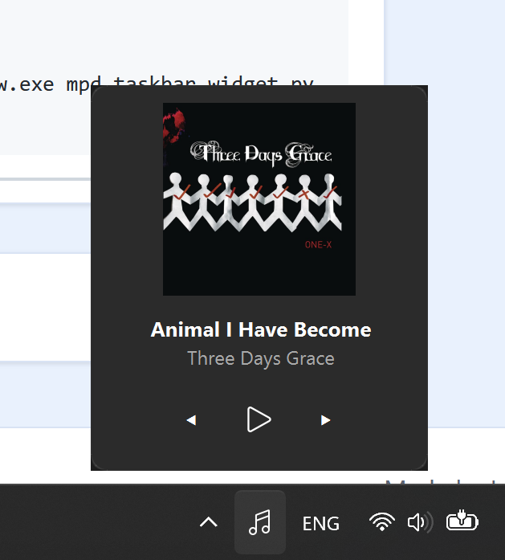

This was built 100% by Gemini free version because I'm a broke student with no coding experience.

# Windows MPD Taskbar Widget

A lightweight, native Fluent Design system tray control widget for Music Player Daemon (MPD) on Windows 11, built with Python, `PySide6`, and `PySide6-Fluent-Widgets`.

## Features

* **System Tray Integration:** Sits discreetly in the system tray.
* **Hover Reveal:** Hovering over the tray icon automatically pops up the widget; moves seamlessly between icon and flyout, hiding automatically when the cursor leaves.
* **One-Click Controls:** Left-clicking the tray icon immediately toggles play/pause without closing the flyout.
* **Smart Positioning:** Click the tray icon to pop up the widget dynamically right above it.
* **Auto-Hiding:** Automatically dismisses when losing focus.
* **Live Album Art:** Fetches and displays current track cover art directly from MPD (`readpicture`).
* **Smooth Marquee:** Seamless left-scrolling continuous loop text for long song titles/artists.
* **Robust Threading:** Background `QThread` polling loop with clean exit synchronization.



---

## Prerequisites

* Python 3.10+ installed and added to your system PATH.
* A running local MPD server (default: `127.0.0.1:6600`).

---

## Setup & Installation

1. **Clone or download** this repository into your project directory.
2. **Open a terminal** inside the project folder and set up a local virtual environment:
```bash
python -m venv .venv

```


3. **Activate the virtual environment**:
* **Command Prompt:** `.venv\Scripts\activate.bat`
* **PowerShell:** `.venv\Scripts\Activate.ps1`


4. **Install dependencies**:
```bash
pip install PySide6 PySide6-Fluent-Widgets python-mpd2

```


---

## Usage

### Running Manually

Run the script using the virtual environment's windowless Python interpreter (`pythonw`):

```bash
.venv\Scripts\pythonw.exe mpd_taskbar_widget.py

```

### Running via Batch Script

Alternatively, use the provided `run-mpd-widget.bat` script to launch it silently in the background without opening a command window:

```bat
@echo off
cd /d "%~dp0"
start /B .venv\Scripts\pythonw.exe mpd_taskbar_widget.py

```

---

## Auto-Start on Windows

1. Right click the `run-mpd-widget.bat` and create shortcut.
2. Press `Win + R`, type `shell:startup`, and press **Enter**.
3. Move the shortcut to the startup folder.
